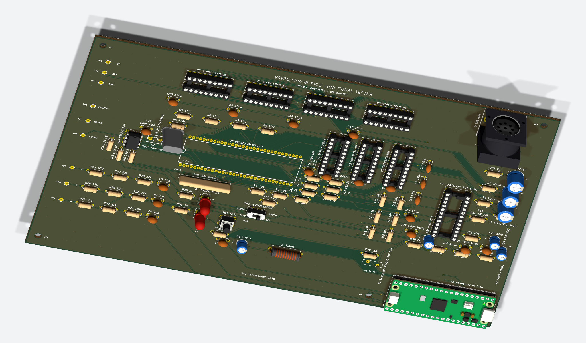
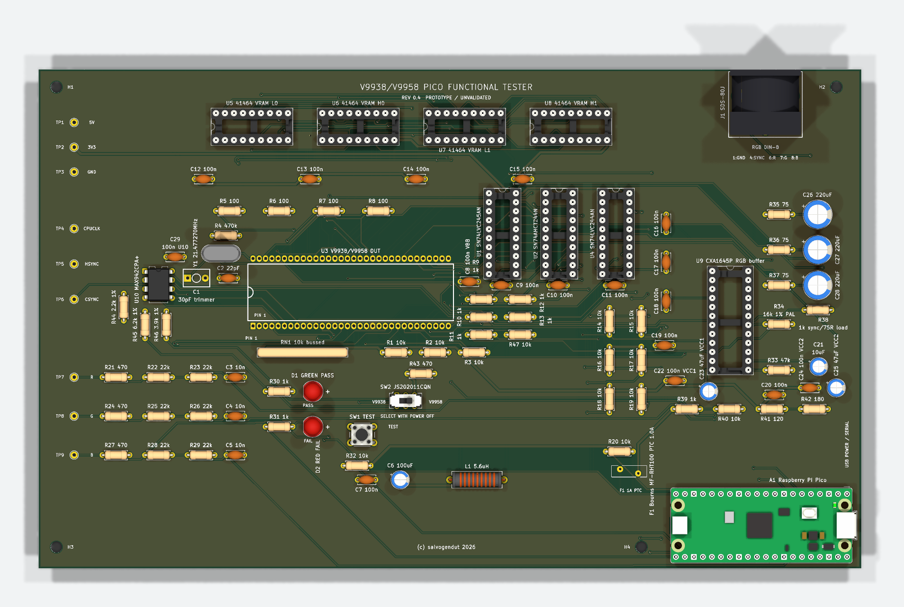
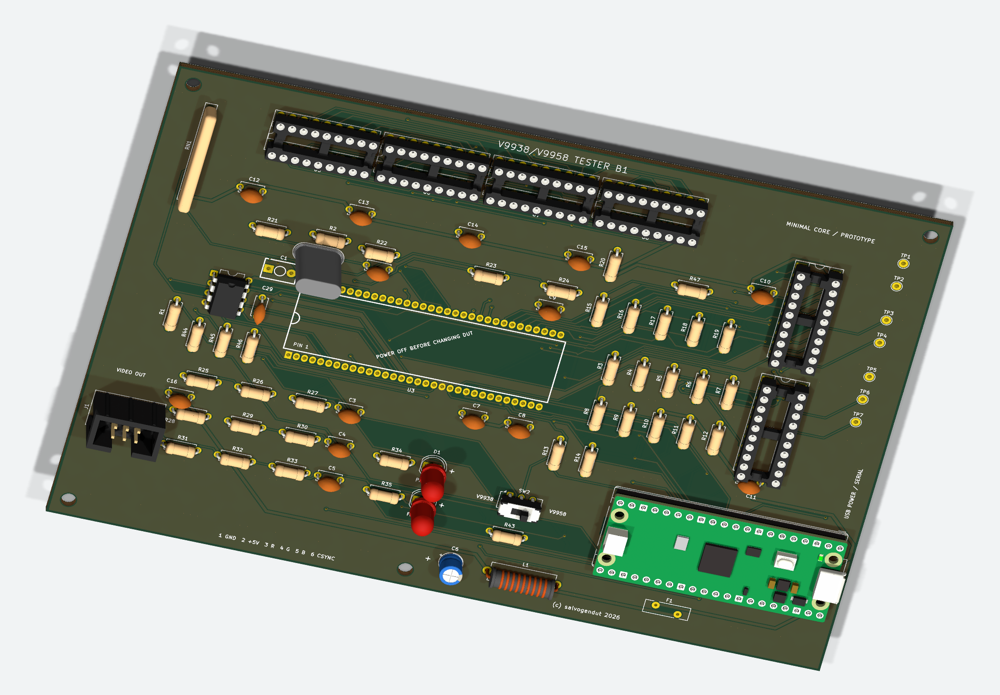
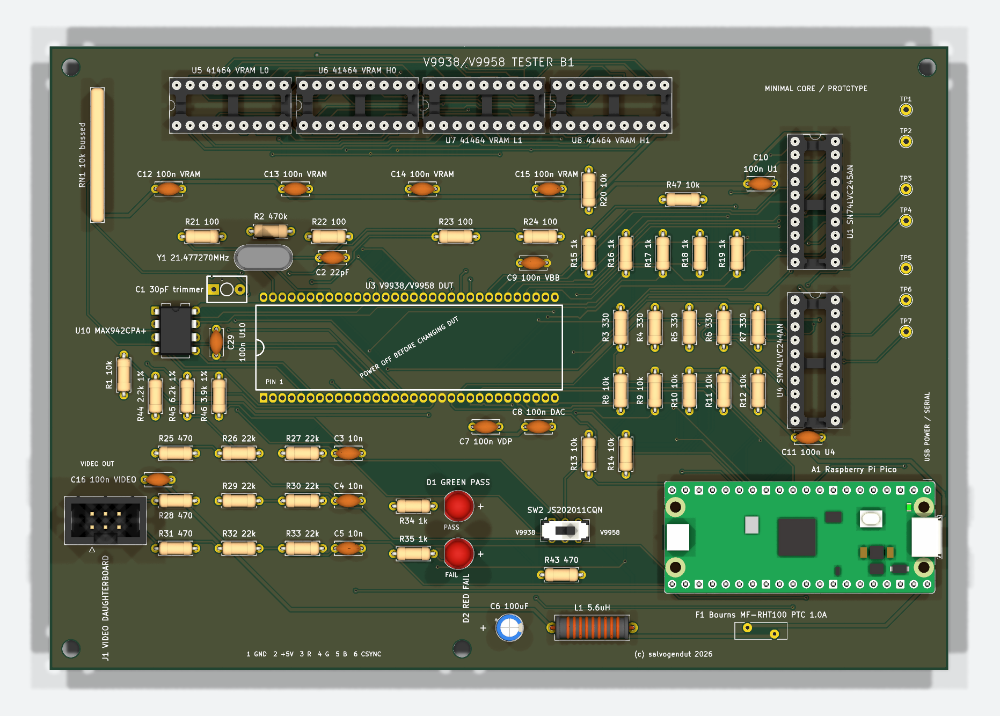
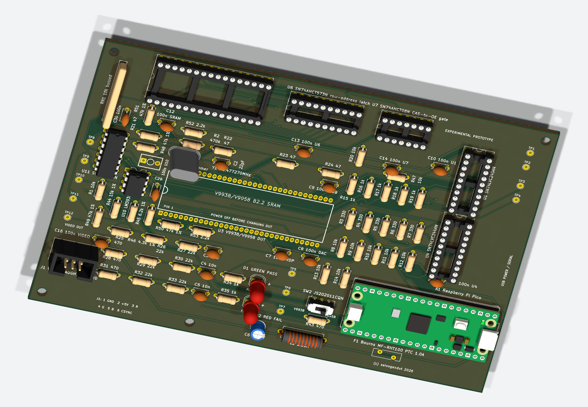
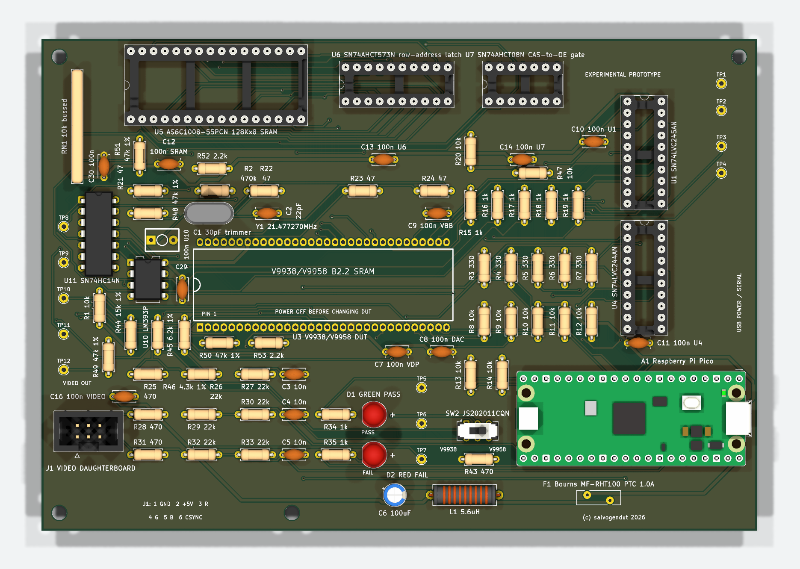
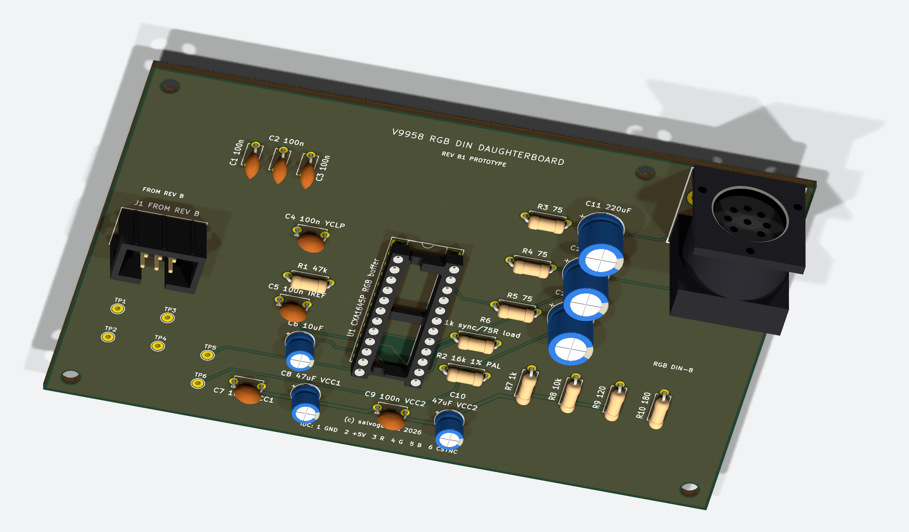
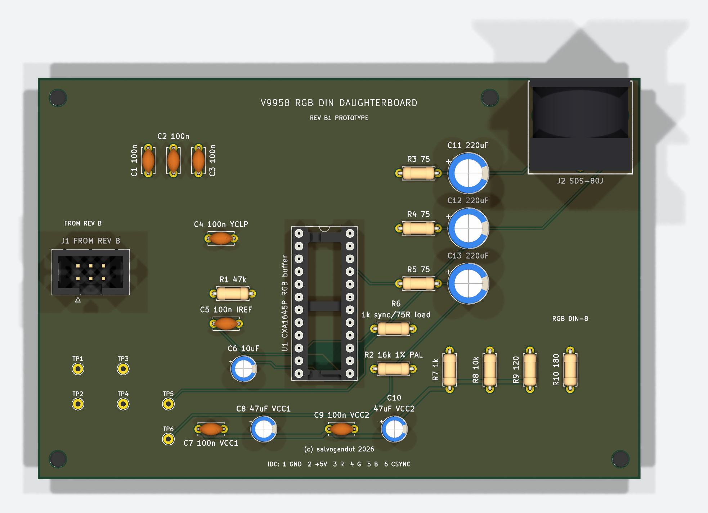

# V9938 / V9958 Pico Functional Tester

This is an all-through-hole carrier board that performs a behavioral test of a socketed Yamaha V9938 or V9958 video display processor. An original RP2040 Raspberry Pi Pico controls the VDP, tests its dedicated 128 KiB VRAM, measures its clocks and analog RGB outputs, and reports the result on green/red LEDs, USB serial, and an on-screen message through an Omega-compatible DIN RGB output.

The current full-size board is **revision 0.5**. U10 is a through-hole TI LM393P dual comparator and U11 is an SN74HC14N sync buffer. The board passes KiCad ERC, DRC and schematic/PCB parity checks. Qualification on real VDPs is pending. [0.5 Gerbers](fabrication/V9958-Tester-rev0.5-gerbers.zip) · [0.5 BOM](docs/BOM.csv)

For a board already marked **0.4**, fit the MAX942CPA+ specified for that circuit. The LM393P requires the revised input dividers and output circuitry. [0.4 BOM](https://github.com/salvogendut/V9958-tester/blob/81ad3057a48962fd7bea91b546fce25a6f905914/docs/BOM.csv) · [Original 0.3 BOM](docs/V9958-Tester-rev0.3-BOM.csv)

**Disconnect USB and set SW2 to the model printed on the chip before inserting it in U3.** The V9938 uses pin 21 as a video output. Selecting V9958 connects that pin directly to the filtered 5 V rail and can damage a V9938. The original 0.3, B0 and B2 tester PCBs have this direct connection permanently. Use a board marked **0.4 or 0.5**, **B1 or B1.1**, or **B2.1 or B2.2 SRAM** for V9938 testing.

**Polarity correction for full-size v0.3 and early v0.4 boards.** Four electrolytics (C25, C26, C27 and C28) have an extra printed `+` on the negative side. On all seven radial capacitors, fit the positive lead to the rounded-square pad 1 and the striped negative lead to circular pad 2. With the components facing you and the DIN socket at the upper right, the stripe goes on the **right**. The corrected [v0.4 Gerbers](fabrication/V9958-Tester-rev0.4-silk2-gerbers.zip) have a single `+` beside each positive capacitor pad. [Assembly checks](docs/TEST-PROCEDURE.md)

## Board renderings



The RGB cable plugs into J1 from outside the top edge. The four VRAM sockets sit above the central U3 footprint, and the Pico USB connector faces the right edge. All four boards print component references and BOM values together on the component side, including the 1% resistor tolerances.



SW2, just above the TEST button, selects V9938 or V9958 with USB power disconnected.

## Revision B family and video daughterboard

Revision B separates the functional tester from the optional monitor output. The
[Revision B core](revision-b/) keeps the socketed VDP, four 41464 VRAMs, one
SN74LVC245 data transceiver, one SN74LVC244 monitor buffer, the oscillator,
power integrity, RGB loads and Pico. The Pico drives the VDP control inputs
directly through 330-ohm series resistors. The CXA1645 and DIN connector have
moved to a separate [RGB DIN daughterboard](video-daughterboard/).





The experimental [Revision B2 SRAM board](revision-b2-sram/) replaces the four
41464 DRAMs with one AS6C1008-55PCN 128Kx8 SRAM, an SN74AHCT573 row-address
latch and an SN74AHCT08 CAS-to-output-enable gate. The Pico still controls and
tests the selected VDP; it does not emulate the timing-critical video RAM bus.





B2 is smaller at 160 x 110 mm and remains entirely through-hole. It includes
dedicated `/RAS`, `/CAS0`, `/CAS1`, SRAM `/OE` and SRAM `/WE` test points. Its
static KiCad checks pass, but its narrow SRAM timing margin has not been
qualified on hardware. Do not use an unqualified B2 fixture to reject a VDP;
confirm failures on a qualified DRAM fixture or a working Omega configured for that chip.





The two boards use a keyed, straight-through 2x3 IDC cable: pin 1 GND, pin 2
+5 V, pin 3 red, pin 4 green, pin 5 blue and pin 6 composite sync. Revision B
passes or fails without the daughterboard; connect it only when an Omega-style
15.6 kHz RGB monitor output and on-screen result are wanted. Both designs are
unbuilt prototypes and have their own BOM, schematic PDF, validation record,
assembly drawing and Gerber archive.

## What it tests

- CPU bus operation through 3.3 V/5 V level translation.
- VDP identification through status register 1, bits 5–1. ID 0 selects V9938 tests and ID 2 selects V9958 tests. Other IDs fail identification.
- Two full address-dependent passes over 128 KiB of local VRAM.
- Approximately 3.58 MHz CPUCLK and 15.6 kHz HSYNC/CSYNC.
- Vertical-blank interrupt assertion and status acknowledgement.
- Red, green, and blue analog-channel response through loaded, divided ADC inputs.

A green LED means all behavioral checks passed. A red LED means at least one check failed; USB serial gives the stage and measurements. A pass is **not forensic proof** that the package was manufactured by Yamaha. A sufficiently compatible clone could pass.

The firmware also leaves a 40-column PAL result screen visible on the DIN RGB output. It shows `PASS` or `FAIL`, the numeric stage code, and the failed subsystem. The screen and USB result identify the detected model. Compare it with the package marking.

## Construction

The tester PCB itself uses no SMD parts. Fit the Pico on two 1x20 through-hole socket strips; the Pico module is, of course, an already assembled module containing SMD components. Use sockets for U1–U9, including a suitable SDIP-64 socket at U3. On revision 0.5, fit the LM393P at U10, the SN74HC14N at U11, and the C&K JS202011CQN model selector at SW2.

Important parts:

- U3 footprint: custom SDIP-64, 1.778 mm pin pitch, 19.05 mm row spacing.
- U5–U8: four 41464-compatible 64Kx4 DRAMs, 120 ns or faster.
- U1: SN74LVC245AN, powered from 3.3 V.
- U2: SN74AHCT244N, powered from 5 V.
- U4: SN74LVC244AN, powered from 3.3 V.
- U9: CXA1645P in DIP-24, used as the three-channel 75-ohm RGB cable buffer.
- J1 takes a Same Sky **SDS-80J**, a standard full-size 270° right-angle DIN-8 socket. It accepts an Omega-wired RGB cable. The shielded SDF-80J with a date code after 03/03/2022 also fits the PCB drawing. [SDS-80J drawing, p. 5](https://www.sameskydevices.com/product/resource/sds-j.pdf) · [DigiKey Italy](https://www.digikey.it/it/products/detail/same-sky-formerly-cui-devices/SDS-80J/97041)
- Y1: 21.477270 MHz crystal; C1 is the 30 pF oscillator trimmer.
- F1: Bourns MF-RHT100 resettable fuse, 1.0 A hold / 1.8 A trip.

The grouped [BOM](docs/BOM.csv), [schematic PDF](docs/V9958-Tester-Schematic.pdf), and [test procedure](docs/TEST-PROCEDURE.md) are in `docs/`. The [fabrication directory](fabrication/) contains the Gerbers and drill files for each full-size dual-model revision.

## Power and handling

Power the board only through the Pico USB connector, from a good 5 V supply capable of at least 1 A. For first power-up, use a current-limited bench supply or USB power limiter. Never insert or remove the V9958, VRAM, logic chips, or Pico while powered.

The board provides native 15.6 kHz PAL RGB through J1. It is suitable for an Omega/MSX RGB cable and a compatible RGB monitor or SCART input; it is **not 31 kHz VGA** and must not be connected to a VGA-only display. J1 follows the Omega assignments: pin 1 ground, pin 3 AV control, pin 4 attenuated composite sync, pin 5 RGB/YS control, pin 6 red, pin 7 green, and pin 8 blue. Pin 2 (audio on an Omega) is unconnected because the tester has no audio source.

U9 reproduces the Omega-style buffered RGB path: 0.1 uF input coupling, CXA1645 clamping/drivers, and 75 ohm plus 220 uF output coupling per colour. J1 pin 4 carries sync only, not composite video. Scope points remain available for 5 V, 3.3 V, ground, CPUCLK, HSYNC, CSYNC, and raw R/G/B.

## Firmware

Firmware source is in `firmware/`. With a Pico SDK toolchain installed:

```sh
export PICO_SDK_PATH=/path/to/pico-sdk
cmake -S firmware -B firmware/build -DPICO_BOARD=pico
cmake --build firmware/build -j4
```

Copy the supplied [full-size tester UF2](firmware/v9958_tester.uf2) or your local build to a Pico in BOOTSEL mode. The program runs once at power-up and again whenever SW1 is pressed. USB CDC serial prints the clock counts, VDP ID, first VRAM mismatch if any, interrupt result, RGB ADC readings, and final stage code. At completion it programs the VDP for PAL text mode and shows the same result through J1.

The compact boards use the shared source. Their images are [B1/B1.1 DRAM](revision-b/firmware/v9958_tester_revb.uf2) and [B2.1/B2.2 SRAM](revision-b2-sram/firmware/v9958_tester_revb2.uf2). They have no TEST
button; send `R` over USB serial to repeat the test.

## Design files and regeneration

- `V9958-Tester.kicad_sch`: native KiCad 10 schematic.
- `V9958-Tester.kicad_pcb`: two-layer routed board with GND pours.
- `V9958-Tester.kicad_pro`: project settings.
- `V9958-Tester.pretty/` contains the VDP socket, trimmer, and Same Sky DIN-8 footprints.
- `tools/`: deterministic schematic, footprint, placement, finish, and BOM generators.

The routing was completed with Freerouting and then imported and checked by KiCad. The checked-in PCB is the release artifact; rerunning the placement generator intentionally produces an unrouted board.

## Known prototype limitations

- RGB pass thresholds are conservative defaults and must be calibrated on known-good samples of both models.
- The full VRAM test and VDP port timing must be verified on physical hardware.
- Socket/ZIF mechanical fit must be checked against the exact part you intend to buy.
- CXA1645 RGB amplitude, sync attenuation, DIN socket fit, and compatibility with the intended Omega RGB cable must be confirmed on the first prototype.
- The test identifies behavior, not die markings or provenance.

