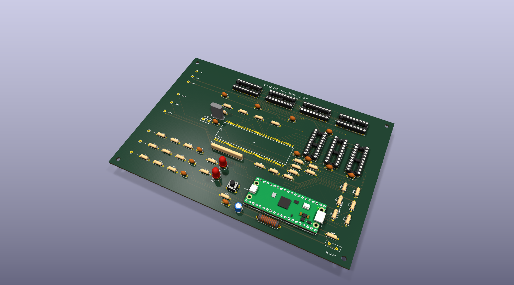
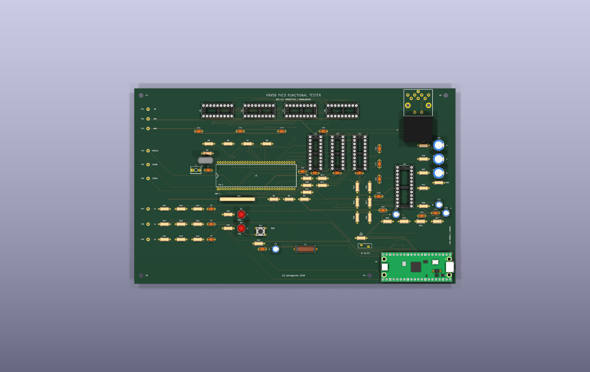
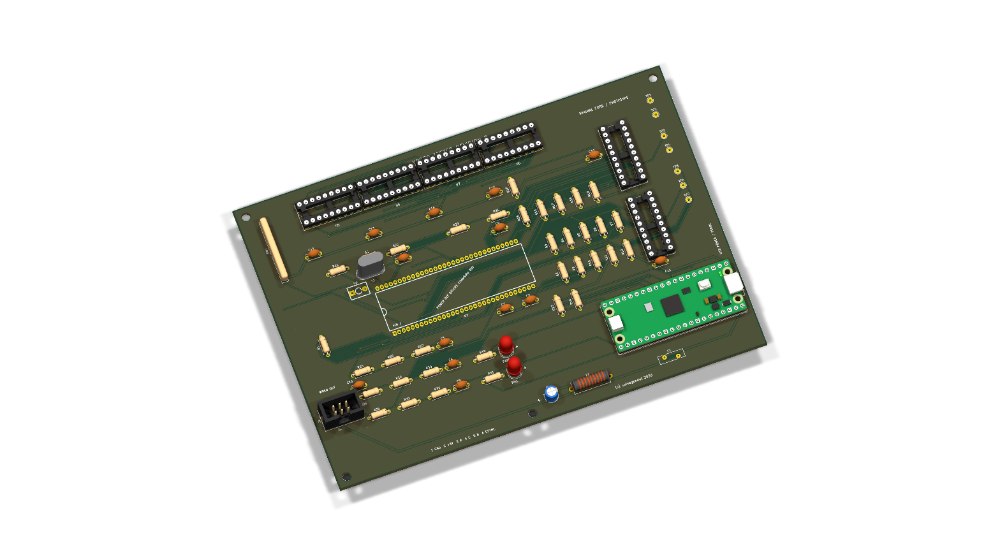
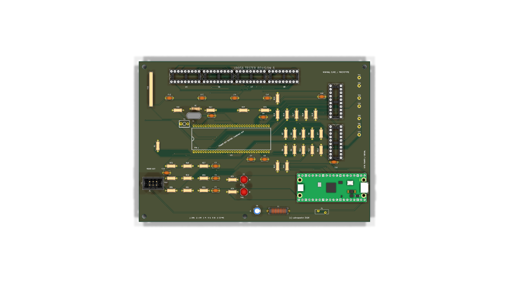
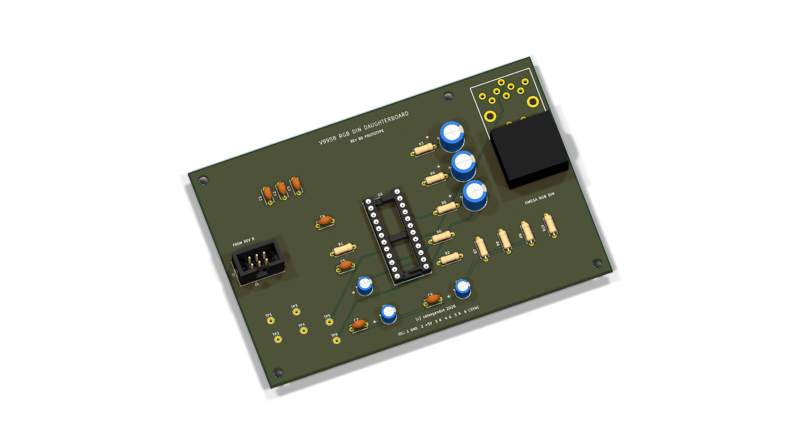
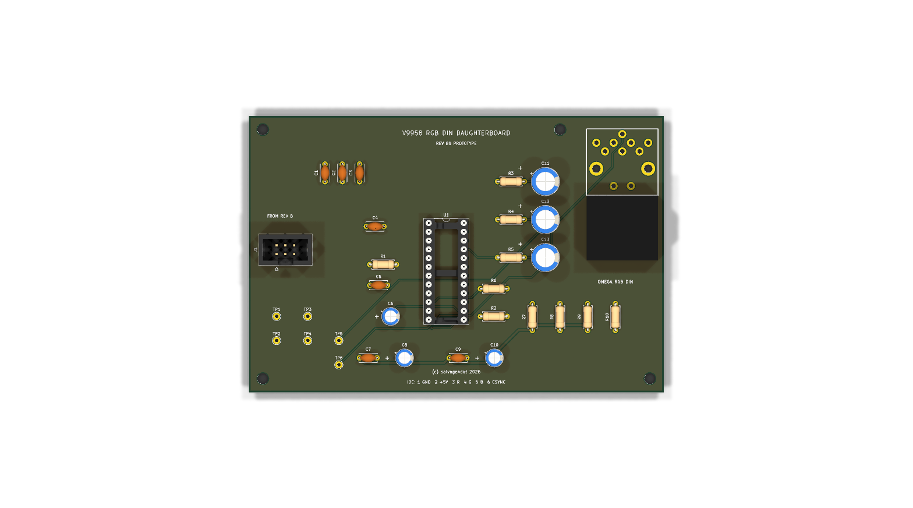

# V9958 Pico Functional Tester

This is an all-through-hole carrier board that performs a behavioral test of a socketed Yamaha V9958 video display processor. An original RP2040 Raspberry Pi Pico controls the VDP, tests its dedicated 128 KiB VRAM, measures its clocks and analog RGB outputs, and reports the result on green/red LEDs, USB serial, and an on-screen message through an Omega-compatible DIN RGB output.

The current design is **revision 0.3, an unbuilt prototype**. It passes KiCad ERC, DRC, connectivity, and schematic/PCB parity checks, but it still needs physical assembly and calibration before it should be treated as a proven fixture.

## Board mockups



Isometric KiCad 3D rendering of the assembled all-THT carrier board. The custom V9958 socket footprint is shown in the center; the four VRAM sockets are along the upper edge, the DIN RGB socket is at the upper-right edge, and the Pico USB connector projects at the right edge for unobstructed cable access.



Orthographic top rendering showing component placement, test points, socket orientation, controls, and front silkscreen.

## Minimal Revision B and video daughterboard

Revision B separates the functional tester from the optional monitor output. The
[Revision B core](revision-b/) keeps the V9958, four 41464 VRAMs, one
SN74LVC245 data transceiver, one SN74LVC244 monitor buffer, the oscillator,
power integrity, RGB loads and Pico. The Pico drives the V9958 control inputs
directly through 330-ohm series resistors. The CXA1645 and DIN connector have
moved to a separate [RGB DIN daughterboard](video-daughterboard/).









The two boards use a keyed, straight-through 2x3 IDC cable: pin 1 GND, pin 2
+5 V, pin 3 red, pin 4 green, pin 5 blue and pin 6 composite sync. Revision B
passes or fails without the daughterboard; connect it only when an Omega-style
15.6 kHz RGB monitor output and on-screen result are wanted. Both designs are
unbuilt prototypes and have their own BOM, schematic PDF, validation record,
assembly drawing and Gerber archive.

## What it tests

- CPU bus operation through 3.3 V/5 V level translation.
- V9958 identification field in status register 1. A V9938 should fail this check.
- Two full address-dependent passes over 128 KiB of local VRAM.
- Approximately 3.58 MHz CPUCLK and 15.6 kHz HSYNC/CSYNC.
- Vertical-blank interrupt assertion and status acknowledgement.
- Red, green, and blue analog-channel response through loaded, divided ADC inputs.

A green LED means all behavioral checks passed. A red LED means at least one check failed; USB serial gives the stage and measurements. A pass is **not forensic proof** that the package was manufactured by Yamaha. A sufficiently compatible clone could pass.

The firmware also leaves a 40-column PAL result screen visible on the DIN RGB output. It shows `PASS` or `FAIL`, the numeric stage code, and the failed subsystem. This gives the V9958 a real display-generation test rather than testing only static RGB levels.

## Construction

The tester PCB itself uses no SMD parts. Fit the Pico on two 1x20 through-hole socket strips; the Pico module is, of course, an already assembled module containing SMD components. Use sockets for U1–U9 and especially the V9958 DUT.

Important parts:

- U3 footprint: custom SDIP-64, 1.778 mm pin pitch, 19.05 mm row spacing.
- U5–U8: four 41464-compatible 64Kx4 DRAMs, 120 ns or faster.
- U1: SN74LVC245AN, powered from 3.3 V.
- U2: SN74AHCT244N, powered from 5 V.
- U4: SN74LVC244AN, powered from 3.3 V.
- U9: CXA1645P in DIP-24, used as the three-channel 75-ohm RGB cable buffer.
- J1: Omega-compatible 8-pin DIN RGB socket using the original Omega footprint and pin numbering.
- Y1: 21.477270 MHz crystal; C1 is the 30 pF oscillator trimmer.
- F1: Bourns MF-RHT100 resettable fuse, 1.0 A hold / 1.8 A trip.

The grouped [BOM](docs/BOM.csv), [schematic PDF](docs/V9958-Tester-Schematic.pdf), and [test procedure](docs/TEST-PROCEDURE.md) are in `docs/`. Gerbers and drill files are in `fabrication/` after running the release export.

## Power and handling

Power the board only through the Pico USB connector, from a good 5 V supply capable of at least 1 A. For first power-up, use a current-limited bench supply or USB power limiter. Never insert or remove the V9958, VRAM, logic chips, or Pico while powered.

The board provides native 15.6 kHz PAL RGB through J1. It is suitable for an Omega/MSX RGB cable and a compatible RGB monitor or SCART input; it is **not 31 kHz VGA** and must not be connected to a VGA-only display. J1 follows the Omega assignments: pin 1 ground, pin 3 AV control, pin 4 attenuated composite sync, pin 5 RGB/YS control, pin 6 red, pin 7 green, and pin 8 blue. Pin 2 (audio on an Omega) is unconnected because the tester has no audio source.

U9 reproduces the Omega-style buffered RGB path: 0.1 uF input coupling, CXA1645 clamping/drivers, and 75 ohm plus 220 uF output coupling per colour. J1 pin 4 carries sync only, not composite video. Scope points remain available for 5 V, 3.3 V, ground, CPUCLK, HSYNC, CSYNC, and raw R/G/B.

## Firmware

Firmware source is in `firmware/`. With a Pico SDK toolchain installed:

```sh
export PICO_SDK_PATH=/path/to/pico-sdk
cmake -S firmware -B firmware/build -DPICO_BOARD=pico
cmake --build firmware/build -j4
```

Copy `v9958_tester.uf2` to a Pico in BOOTSEL mode. The program runs once at power-up and again whenever SW1 is pressed. USB CDC serial prints the clock counts, VDP ID, first VRAM mismatch if any, interrupt result, RGB ADC readings, and final stage code. At completion it programs V9958 PAL text mode and shows the same result through J1.

Revision B uses the same source with a separate build in `revision-b/firmware/`.
It has no TEST button; send `R` over USB serial to repeat the test.

## Design files and regeneration

- `V9958-Tester.kicad_sch`: native KiCad 10 schematic.
- `V9958-Tester.kicad_pcb`: two-layer routed board with GND pours.
- `V9958-Tester.kicad_pro`: project settings.
- `V9958-Tester.pretty/`: custom V9958, trimmer, and Omega DIN-8 footprints.
- `tools/`: deterministic schematic, footprint, placement, finish, and BOM generators.

The routing was completed with Freerouting and then imported and checked by KiCad. The checked-in PCB is the release artifact; rerunning the placement generator intentionally produces an unrouted board.

## Known prototype limitations

- RGB pass thresholds are conservative defaults and must be calibrated on known-good V9958 samples.
- The full VRAM test and VDP port timing must be verified on physical hardware.
- Socket/ZIF mechanical fit must be checked against the exact part you intend to buy.
- CXA1645 RGB amplitude, sync attenuation, DIN socket fit, and compatibility with the intended Omega RGB cable must be confirmed on the first prototype.
- The test identifies behavior, not die markings or provenance.

