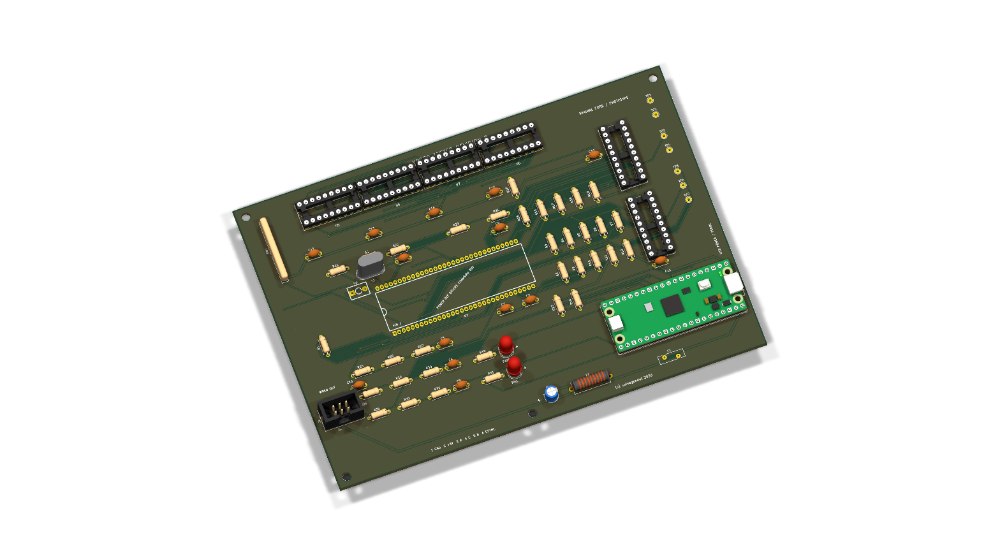
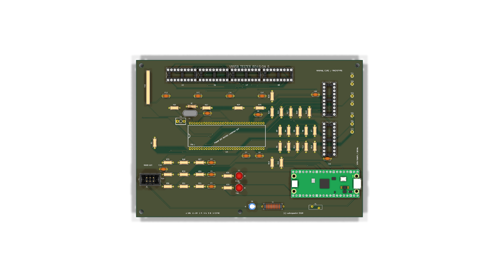

# V9958 Tester Revision B

Revision B is the minimal all-through-hole V9958 functional tester. It is a
170 x 118 mm, two-layer core board powered through the Pico USB connector. It
performs the same V9958 identification, CPU bus, 128 KiB VRAM, sync, interrupt
and RGB-response tests as revision 0.3 without requiring a CXA1645 or monitor.

## What was simplified

- The SN74AHCT244 control buffer is gone. Pico 3.3 V outputs satisfy the
  V9958's 2.2 V minimum high threshold and reach it through 330-ohm resistors.
- The CXA1645 and DIN connector are on the optional video daughterboard.
- The TEST button is omitted. Send `R` over USB serial to repeat a run.
- The V9958, four 41464 VRAMs, crystal network, RGB loads, decoupling and
  filtered 5 V rail remain because they are intrinsic to a trustworthy test.
- U4 remains an SN74LVC244 powered at 3.3 V. Its 5 V-tolerant inputs avoid
  loading the V9958's relatively weak clock/sync outputs and protect the Pico.

J1 is a keyed 2x3 IDC video expansion header: 1 GND, 2 +5 V, 3 red, 4 green,
5 blue and 6 CSYNC. Use a straight-through cable to the matching daughterboard.

The grouped [BOM](docs/BOM.csv), [schematic PDF](docs/V9958-Tester-RevB-Schematic.pdf),
[test procedure](docs/TEST-PROCEDURE.md), [design notes](docs/DESIGN-NOTES.md)
and [validation record](docs/VALIDATION.md) are included. This is an unbuilt,
unvalidated prototype; zero ERC/DRC violations do not substitute for physical
qualification with known-good and known-bad V9958 samples.
