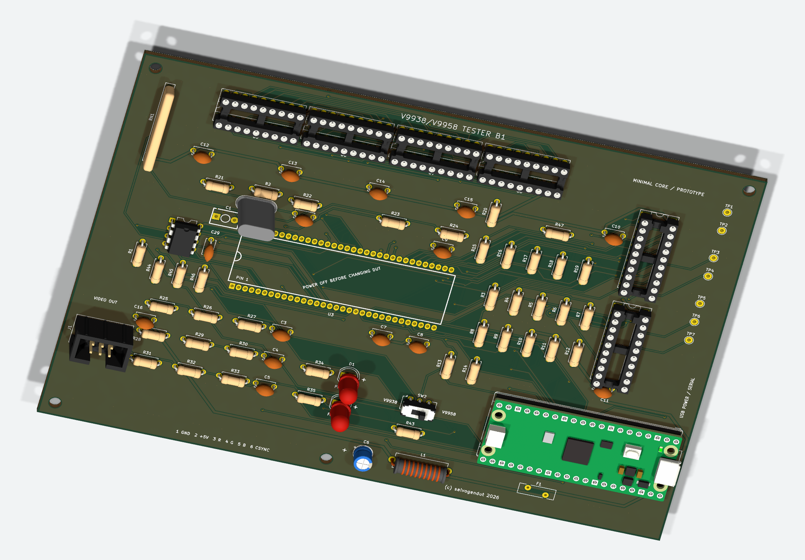
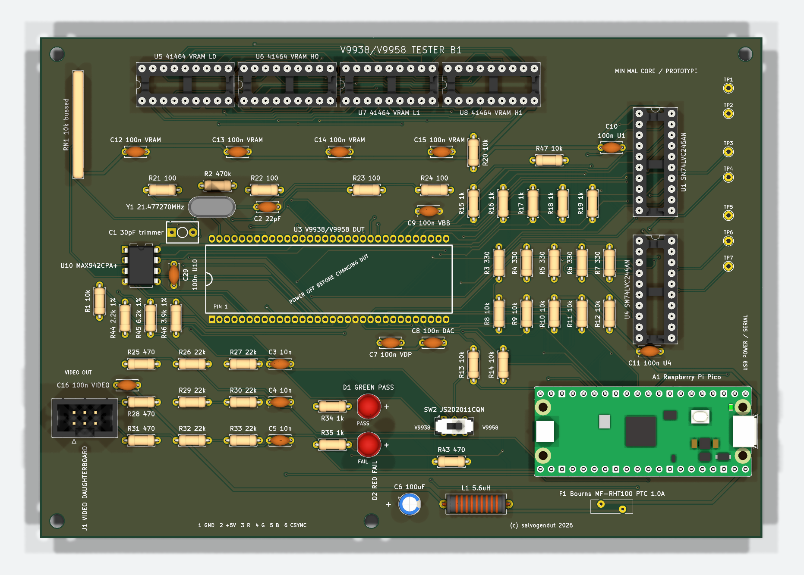
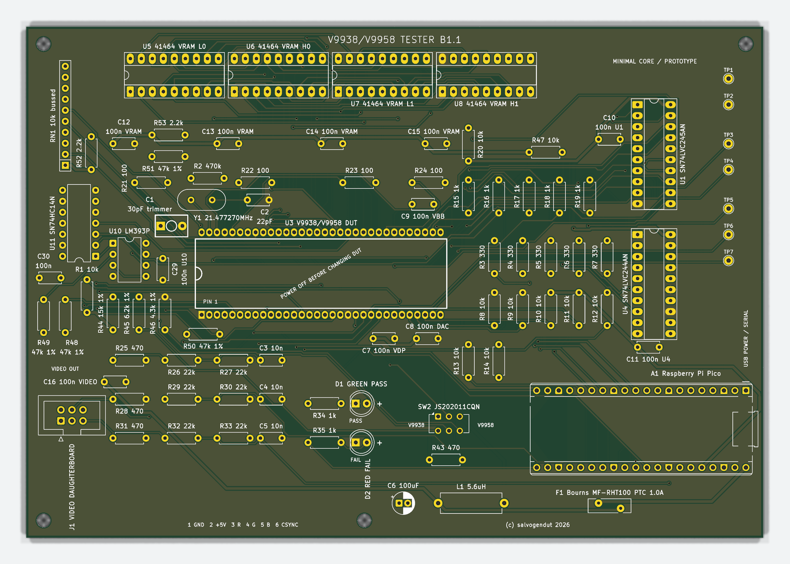
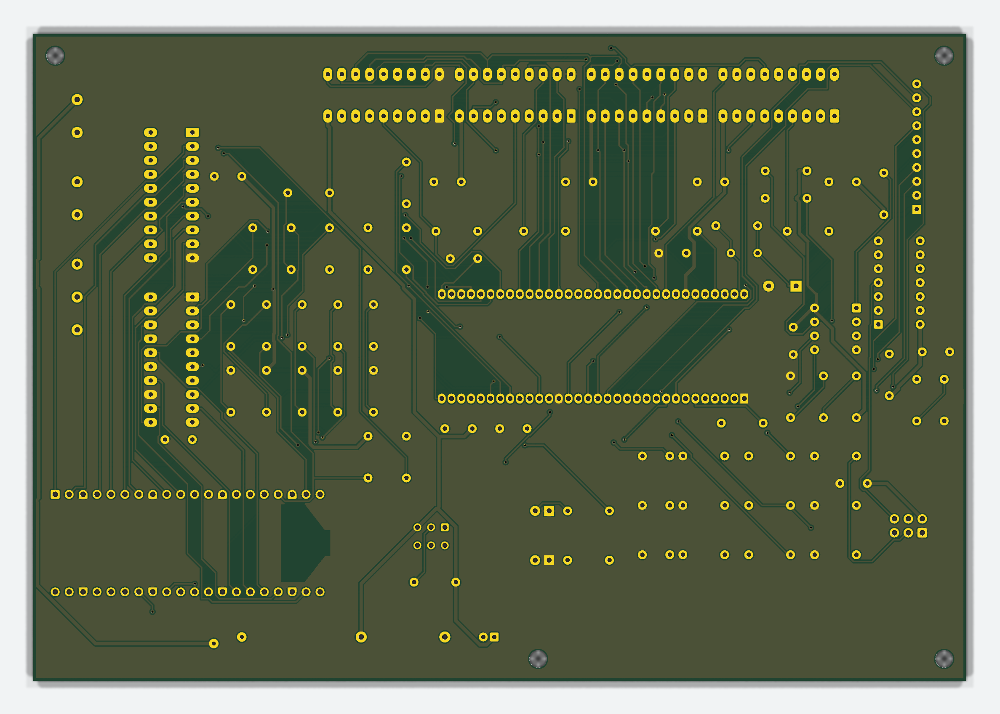

# V9958 Tester Revision B

**Use PCB B1 or B1.1 for V9938 or V9958.** Disconnect USB, set SW2 to the package marking, then insert the DUT. Earlier boards without SW2 connect pin 21 directly to 5 V and can damage a V9938. See the [selector checks](docs/TEST-PROCEDURE.md).

PCB **B1.1** uses an LM393P at U10 and an SN74HC14N at U11. PCB **B1** uses a MAX942CPA+ at U10. [B1.1 BOM](docs/BOM.csv) · [B1.1 Gerbers](fabrication/V9958-Tester-RevB-B1.1-gerbers.zip) · [B1 BOM](https://github.com/salvogendut/V9958-tester/blob/81ad3057a48962fd7bea91b546fce25a6f905914/revision-b/docs/BOM.csv)

Revision B is the minimal all-through-hole V9938/V9958 functional tester. It is a
170 x 118 mm, two-layer core board powered through the Pico USB connector. It
performs the same VDP identification, CPU bus, 128 KiB VRAM, sync, interrupt
and RGB-response tests as the full-size tester without requiring a CXA1645 or monitor.

## B1.1 board renderings

| Assembled angled view | Assembled top view |
|---|---|
|  |  |

| Bare component side | Bare solder side |
|---|---|
|  |  |

## What was simplified

- The SN74AHCT244 control buffer is gone. Pico 3.3 V outputs satisfy the
  V9958's 2.2 V minimum high threshold and reach it through 330-ohm resistors.
- The CXA1645 and DIN connector are on the optional video daughterboard.
- The TEST button is omitted. Send `R` over USB serial to repeat a run.
- The V9958, four 41464 VRAMs, crystal network, RGB loads, decoupling and
  filtered 5 V rail remain because they are intrinsic to a trustworthy test.
- U4 remains an SN74LVC244 powered at 3.3 V. Its 5 V-tolerant inputs avoid
  loading the VDP clock output. U10 and U11 condition HSYNC and CSYNC before U4.

J1 is a keyed 2x3 IDC video expansion header: 1 GND, 2 +5 V, 3 red, 4 green,
5 blue and 6 CSYNC. Use a straight-through cable to the matching daughterboard.

The grouped [BOM](docs/BOM.csv), [schematic PDF](docs/V9958-Tester-RevB-Schematic.pdf),
[test procedure](docs/TEST-PROCEDURE.md), [design notes](docs/DESIGN-NOTES.md)
and [validation record](docs/VALIDATION.md) are included. This is an unbuilt,
unvalidated prototype; zero ERC/DRC violations do not substitute for physical
qualification with known-good and known-bad samples of both models.
