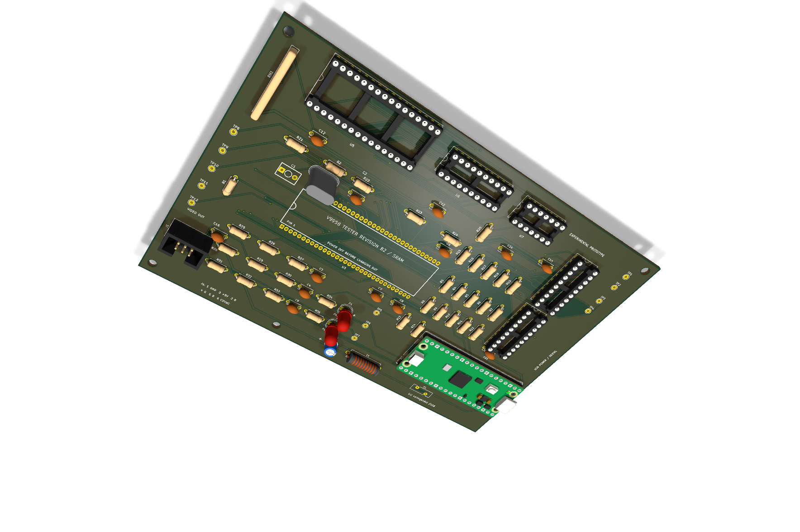
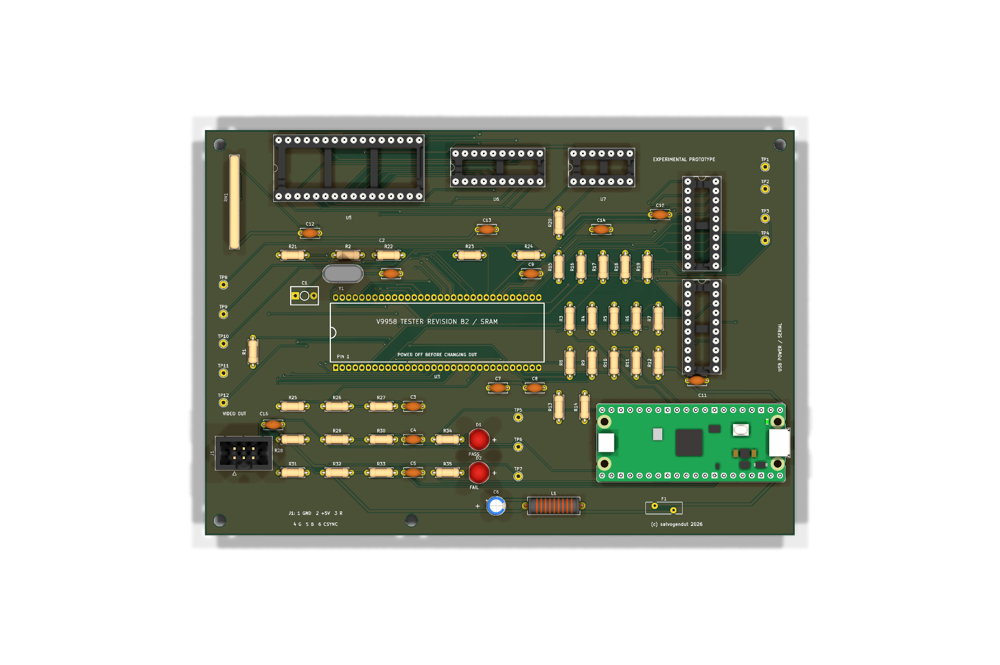

# V9958 Tester Revision B2 SRAM

Revision B2 is an experimental all-through-hole variant of the V9958 tester.
It replaces Revision B's four 41464 DRAMs with one AS6C1008-55PCN 128Kx8
asynchronous SRAM, one SN74AHCT573N row-address latch and one SN74AHCT08N
CAS-to-output-enable gate. The Pico still performs the test; it does not
emulate cycle-accurate video RAM.

The V9958 presents each memory address in two halves. U6 captures the row
address when `/RAS` falls. The live address becomes SRAM A0-A7, the latched
row becomes A8-A15, and `/CAS0` becomes A16. U7 asserts SRAM `/OE` when either
`/CAS0` or `/CAS1` is active. SRAM `/CE` is held low and V9958 `R/W` drives
SRAM `/WE` through a 47-ohm damping resistor.

This adaptation is intentionally marked **EXPERIMENTAL PROTOTYPE**. Static
ERC/DRC and connectivity checks cannot prove that the SRAM interface meets
the V9958's dynamic memory timing. Before trusting it as a chip tester, build
one unit and qualify TP8-TP12 with a known-good V9958 over supply and
temperature. Do not substitute slower SRAM.

J1 has the same keyed 2x3 video expansion pinout as Revision B: 1 GND, 2 +5 V,
3 red, 4 green, 5 blue and 6 CSYNC. It works with the existing optional RGB
DIN daughterboard.

The grouped [BOM](docs/BOM.csv), [schematic PDF](docs/V9958-Tester-RevB2-SRAM-Schematic.pdf),
[test procedure](docs/TEST-PROCEDURE.md), [design notes](docs/DESIGN-NOTES.md)
and [validation record](docs/VALIDATION.md) are included.
