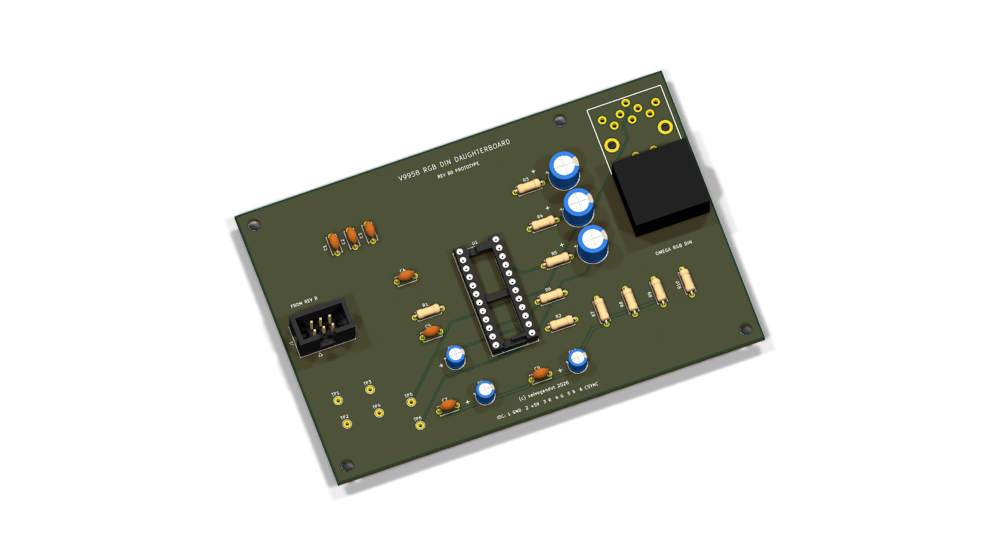
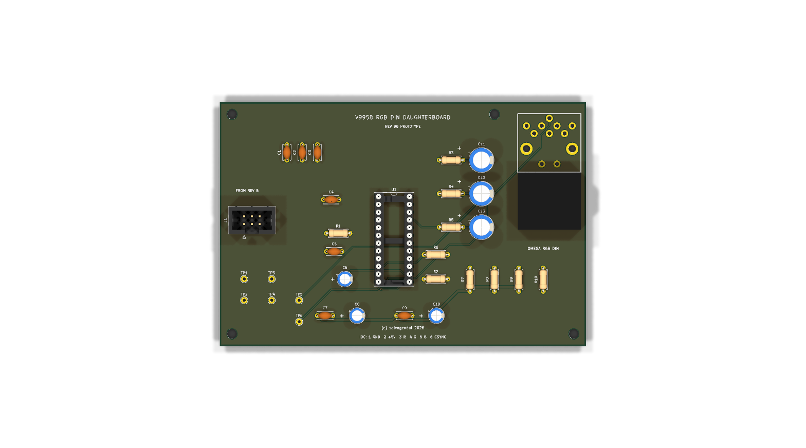

# V9958 RGB DIN daughterboard

This optional all-through-hole 120 x 80 mm board moves the CXA1645P RGB cable
drivers and Omega-compatible DIN-8 connector away from the minimal Revision B
tester core.

J1 uses a keyed straight-through 2x3 IDC cable: 1 GND, 2 +5 V, 3 red, 4 green,
5 blue and 6 CSYNC. J2 follows the Omega RGB assignments: pin 1 GND, pin 3 AV
control, pin 4 composite sync, pin 5 RGB/YS control, pin 6 red, pin 7 green and
pin 8 blue. Pin 2 is unconnected because the tester has no audio source.

The output is native 15.6 kHz PAL RGB, not VGA. The board does not create
composite video; J2 pin 4 is sync only. See the [schematic PDF](docs/V9958-Video-Daughterboard-Schematic.pdf),
[BOM](docs/BOM.csv), [test procedure](docs/TEST-PROCEDURE.md) and
[validation record](docs/VALIDATION.md). This remains an unbuilt prototype.
